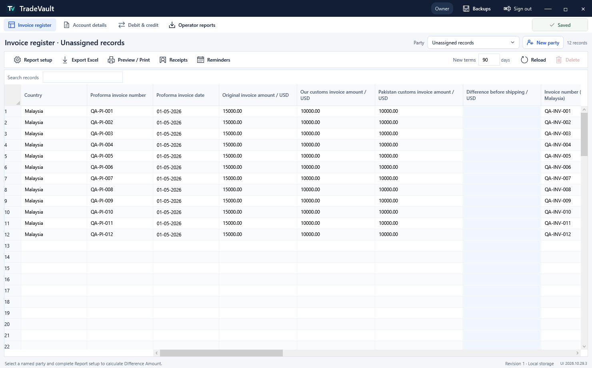
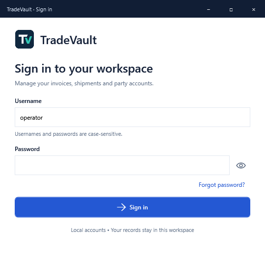
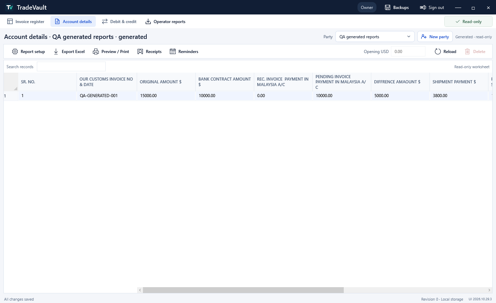

<p align="center">
  
</p>

<h1 align="center">TradeVault</h1>

<p align="center">
  <strong>Export records. Customer payments. Clear party accounts.</strong><br>
  An offline Windows desktop application designed for independent Owner and Operator USB workspaces.
</p>

<p align="center">
  
  
  
  
  
</p>

<p align="center">
  <a href="#quick-start">Quick start</a> ·
  <a href="#screenshots">Screenshots</a> ·
  <a href="#operator-to-owner-handover">Excel handover</a> ·
  <a href="#database-and-local-storage">Database</a> ·
  <a href="#testing-and-current-status">Testing</a> ·
  <a href="#troubleshooting">Troubleshooting</a> ·
  <a href="#documentation">Documentation</a>
</p>

## Overview

TradeVault replaces scattered export-tracking worksheets with party-specific invoice registers, shipment records, payment allocations and account reports. It is built around a company exporting dyes from India, including shipments routed through Malaysia.

The application runs locally without an application server or internet connection. Owner and Operator use separate application folders and databases. The Operator exports an Excel report; the Owner imports a frozen copy for review. Working databases are independent.

**Current source build:** `UI 2026.10.31.10` · **Database schema:** `13`. Upgrades schemas 9, 11, 12 and the recognized additive schema 10 with an automatic pre-upgrade backup.

**Reusable design reference:** [design.md](design.md) describes the general visual system without project-specific information, so it can be used for other applications. The October 30 interface opens directly into the workspace and no longer includes the earlier authentication/role/inbox screens or Report setup toolbar action; descriptions of those features below belong to the earlier functional baseline.

### Recent changes reflected in this documentation

- **Receipt tab correction:** restored Party Receipt and Agent Receipt as empty placeholder tabs, in their original positions before Reports. The removed receipt-entry module remains unavailable.

- **Invoice identity order:** Party name, Agent name, Invoice number, Invoice date, Country name. All five are read-only; only the first three are frozen. Invoice number/date are the existing F3/F4 proforma identity fields under clearer labels; separate India invoice fields remain.
- **Receipt removal:** removed the Receipts button, receipt-entry window, receipt shortcut and both receipt tabs. Current tabs are Party Master, Agent Master, Invoice Register and Reports. Recorded payment history remains stored for accurate balances; this update does not erase financial history.
- **Reminders and window layout:** Reminders is enabled for All parties and follows current party/agent/search filters. The filter row is compact and single-line. Custom window maximization now uses the current monitor work area so the footer and worksheet scrollbar remain above the taskbar.

- **Current-page export:** one Export dropdown provides Export to Excel and Export to PDF. It exports only the visible rows/columns of the open page, respecting filters, search and sort. Party/Agent Masters export their own two-column tables. Empty placeholder pages have Export disabled.
- **Invoice identity:** Party name is now the first visible, locked/frozen column, followed by the previous 20 columns. New Invoice includes a required Party Master selector and can be opened from the All parties view. The first five identity columns are locked/frozen.
- **Header and filters:** the active page name appears beside TradeVault in the title bar. The row below shows the applied party/agent criteria, with refreshed dropdown styling. Unassigned is no longer offered in the Party dropdown; existing legacy records remain available under All parties. Reports and Backups have new document-chart/archive icons.

- **Invoice filters:** Party and Agent dropdowns combine with AND semantics. Start with All parties / All agents, select an agent to view it across parties, or select both to narrow to their intersection. Text search further narrows the result. All parties is a read-only overview; select a specific party to edit or use party-scoped invoice actions.

- **Locked columns:** country, agent and proforma identity columns now use shaded cells and blue headers, with theme-aware colors and normal selection highlighting.
- **Agent display:** the agent selector renders only the agent name, including after selection. Three clearly marked `[TEST]` agents were added on request and assigned to previously blank invoice agent fields, with a safety backup. Existing assignments and payment data were preserved.
- **Backups:** moved to the title bar, immediately left of Minimize, available from every tab.

- **Six tabs:** Party Master, Agent Master, Invoice Register, Party Receipt, Agent Receipt, Reports. The two receipt tabs and Reports are intentionally empty placeholders for this phase. Existing receipt/report tools remain on the Invoice Register toolbar.
- **Masters:** create parties only in Party Master and agents only in Agent Master. Each master has a read-only Excel-style name/invoice-count table. Counts include saved draft invoices and exclude deleted blank rows. New Invoice uses a non-editable dropdown of saved agents; no free-text agent creation is available in the register.
- **Hover UI:** removed the Invoice Register heading tooltip and disabled navigation-tab hover tooltips.

- **New Invoice:** opens a four-field modal for country, agent, proforma number and proforma date. Add record stores the draft under the selected party. These identity fields are read-only and the first four columns remain frozen while scrolling. Fill in amounts and shipment details in the grid, then Save changes.
- **Deadline override:** the editable payment due date drives reminder date, overdue days, payment balances and reports. A custom date remains fixed if the agent BL date changes; clear it to restore BL + 90. Incomplete new drafts are excluded from financial reports until India invoice number/date and original/customs amounts are complete.

- **Register simplification (October 31):** removed Shipping Charge and the five earlier receipt/payment columns. Earlier receipt values/dates remain stored for existing payment balances; new payments use Receipts. The register now has 20 visible columns plus its row header; party is selected above the grid.
- **Shipping removal:** schema 11 drops `invoices.shipping_cents` and removes `F18` from active register JSON. Backend invoice contracts, defaults, validations and report deductions no longer include shipping. Account Details also omits its shipment-payment column; historical audit snapshots and safety backups remain intact.

- **Customer payments:** a dedicated screen shows unpaid bank/difference portions, editable payment allocations, live totals, advances and payment history.
- **Reporting:** the main UI no longer exposes As of, Recalculate, row density or Selected terms. Generated tabs, previews and main Excel exports include **all saved records**, including future-dated entries. Reminders and payment-entry balances still use their own effective dates.
- **Editing:** clearing/cutting cells remains a draft operation. Confirmed whole-record deletion/cutting saves that one removal immediately, preserving unrelated draft edits.
- **Navigation:** New party, vector tab icons, keyboard shortcuts and compact headers replace earlier layouts. Invoice register labels are clearer; internal field keys and stored records remain compatible.

Current instructions in this README take precedence over older dated work logs and screenshots. The complete earlier README remains in the expandable development history below.

## Features

| Area | What is implemented |
|---|---|
| Authentication | Predefined Owner/Operator accounts, case-sensitive sign-in, password visibility toggle and offline single-use recovery codes |
| Party workspaces | Separate registers, balances and report settings per party; selected party inherited by new invoices |
| Excel-style entry | Keyboard navigation, search, frozen identifiers, copy/cut/paste, row selection and protected calculated cells |
| Shipment tracking | Proforma/invoice references, containers, BL dates, arrival dates and payment terms |
| Payments | Partial receipts, one payment allocated across invoices, bank/difference portions, unallocated advances and dated corrections/reversals |
| Reports | Account Details and Debit & Credit derived from saved records; automatic recalculation and current all-record views |
| Reminders | Party and invoice references, outstanding amounts, due-soon/overdue status and settled/BL-pending cases |
| Excel handover | A readable `.xlsx` filename, two report tabs, automatic opening after export and Owner import/preview/review |
| PDF and print | Direct paginated PDF output plus Windows printing, with PDF fallback when Windows printing fails |
| Data safeguards | Transactional SQLite saves, stale-revision protection, date/USD validation, backups, verified restore and migrations |

All financial amounts are **USD**. New invoices default to **agent country BL date + 90 calendar days**. The payment due date is editable; clearing it restores the automatic default. Shipping charges have been removed. Changing new-record terms does not rewrite existing invoices.

## Screenshots

Screenshots below use **synthetic QA data**, not company transactions.

### Invoice workspace



<details>
<summary>View sign-in and generated account report</summary>





</details>

## Quick start

### Development prerequisites

- Windows with the **.NET 10 SDK**.
- Git, if cloning or collaborating on the repository.
- Internet access for the initial dependency restore. Normal application use is offline.

From the repository root:

```powershell
dotnet restore TradeVault.sln
dotnet build Src/TradeVault.Desktop/TradeVault.Desktop.csproj --no-restore
dotnet run --no-restore --project Src/TradeVault.Desktop/TradeVault.Desktop.csproj
```

Close the running application before rebuilding; Windows locks application files while they are in use.

The normal Debug executable is created at:

```text
Src/TradeVault.Desktop/bin/Debug/net10.0-windows/TradeVault.Desktop.exe
```

### First use

1. Sign in with the provisioned Owner or Operator account. Usernames are case-sensitive: `owner` and `operator`.
2. Create and select a named party using **New party**.
3. Complete **Report setup** for that party: select the actual contract/receipt sources, opening balances and shipping treatment. These business meanings are not guessed automatically.
4. Enter invoice and shipment records. Calculated values refresh automatically; save ordinary edits with **Save changes** or **Ctrl+S**.
5. Open **Receipts** to allocate customer payments. Use **Reminders** for follow-up, or open the report tabs to review balances.
6. Export Excel or use **Preview / Print** for report output.

Keep account passwords outside the repository documentation. Save a recovery code separately before relying on **Forgot password**; see the [offline recovery guide](Docs/Offline-Account-Recovery.md).

### Report setup and calculation rules

Select a named party before opening **Report setup**. Settings are per party, not shared between USB installations.

| Setting | Meaning |
|---|---|
| Contract source | Choose the actual bank-contract amount source: our customs amount (`F6`) or Pakistan customs amount (`F7`). These amounts are not assumed to mean the same thing. |
| Earlier bank receipts source | Choose MY → PK receipts (`F22`, dated `F24`) or Nemichem receipts (`F25`, dated `F26`). |
| Earlier difference receipts | The generated workflow uses `F23`, dated `F24`, for earlier difference payments. |
| Shipping treatment | When enabled, deduct each invoice row's registered shipping amount once on its invoice date. When disabled, generated balances exclude this deduction. |
| Opening balances | Enter bank and difference amounts outstanding before the invoices being entered, together with their effective date. Use zero if there is no earlier outstanding balance. |

The company must confirm the source choices. Once a party has recorded receipt history, mappings cannot be changed through ordinary setup. Do not duplicate an outstanding amount in both opening balances and entered invoices.

The generated calculation uses:

```text
Difference before shipping = Original invoice amount − Selected contract amount
Net difference             = Difference before shipping − Approved shipping deduction
Bank unpaid                = Contract amount − Earlier bank receipts − Allocated bank payments
Difference unpaid          = Net difference − Earlier difference receipts − Allocated difference payments
Invoice unpaid             = Bank unpaid + Difference unpaid
Due date                   = Malaysia → Pakistan BL date + Invoice terms in calendar days
```

An unallocated advance reduces the party's ledger balance but does not settle any particular invoice. Opening balances are not aged against individual invoices. Generated report tabs are read-only; update their saved register/payment sources instead.

Before setup is complete, independently entered Account Details and Debit & Credit worksheets may still be displayed. They are preserved data, not automatically reconciled generated reports. The old manual-report toggle has been removed.

### Recording, correcting and cancelling payments

1. Save the party's invoice records and complete Report setup.
2. Open **Receipts** (`Ctrl+Shift+R`) to enter **Customer payments**.
3. Enter the date money was received, the total in USD and a description/bank-transfer reference.
4. Review the unpaid balances at that date. Enter amounts only in **Pay bank portion** and **Pay difference portion** for the invoices being paid.
5. Check the automatically updated assigned amount, unassigned advance and unpaid-after-payment amounts.
6. Choose **Save new payment**. This saves the payment directly and refreshes balances; it is separate from saving worksheet drafts.

Example: two invoices each have USD 10,000 bank unpaid and USD 1,200 difference unpaid. For a USD 8,000 transfer, assign USD 6,000 to invoice A's bank portion and USD 2,000 to invoice B's bank portion. A then owes USD 5,200 in total and B owes USD 9,200. If only USD 7,500 is assigned, USD 500 remains an advance.

Open **Recorded payments** to select an active payment. **Edit selected payment / assign its advance** opens correction mode; choose the date the correction takes effect and save it. The original is retained with reversal/replacement movements. **Cancel recorded payment** requires an effective date and reason; it reverses the recorded allocations and does not initiate a bank refund.

Do not record the same money twice: the register's **Earlier receipts** fields are cumulative starting amounts, while this screen records additional dated payments. Future invoices are excluded from the payment-date balance list. Pre-invoice money can be saved as an unallocated advance and assigned later through correction.

### Reminders and report dates

**Reminders** shows the selected party's invoice references, due dates, unpaid USD amounts, overdue days and statuses: Settled, BL pending, Not yet due, Due within 30 days, or Overdue. A missing Malaysia → Pakistan BL date leaves the due date unknown. Same-day payments are valid; overdue is determined from the due date, not from the payment description.

Reminders use today's date. Main report tabs/exports use all saved records, so a future-dated invoice/payment can appear in a report while being absent from today's reminders or an earlier payment-date balance list. A report's prepared date is **not** a transaction cutoff. The date-filtered `ReportWorkflow.Build` service remains available internally; the current main UI calls `BuildCurrent`.

### Validation and save behavior

- Party and invoice references are required; invoice references and stable IDs must be unique within the party.
- USD amounts must be non-negative, within the supported limit of USD 1 trillion per entered amount, and have at most two decimal places.
- When dates are supplied, proforma/invoice/BL/arrival dates must follow their shipment sequence. A payment allocated to an invoice cannot predate its invoice; positive earlier receipt amounts require their effective payment dates.
- Payment allocations must belong to the selected party, fit the receipt total and not exceed their bank/difference components at any effective-date checkpoint.
- Payment terms must be 0–3650 calendar days and cannot produce a date beyond the supported range.
- Concurrent/stale worksheet revisions are rejected. Invoices with receipt history cannot be deleted, and protected historical amount/date inputs cannot be overwritten by ordinary editing.

Required-field/business checks run when saving/posting, rather than displaying a missing-field warning after every cell edit. Failed saves leave stored records unchanged. Unknown shipment dates can remain blank; a new invoice need not have completed its entire shipment lifecycle to be entered.

### Editing and deletion

- **Delete** on editable cells clears the selection without a confirmation dialog. These changes remain drafts until saved.
- Click a row number to select a whole record. **Delete** then requests confirmation and saves that record's removal **immediately**.
- **Ctrl+X** cuts editable cells, or requests confirmation when cutting a whole record. Clipboard failure leaves the input unchanged.
- **Ctrl+V** pastes inputs; calculated columns are recalculated. A copied invoice needs a new unique reference before saving.
- Records linked to payment history are protected from deletion. Confirmed record removal does not save unrelated draft edits.

The main toolbar no longer exposes manual **As of**, **Recalculate** or row-density controls. Main reports include all saved entries, including future-dated ones; the prepared date is not a historical cutoff. Reminder aging uses today's date, and receipt/correction dates still control payment validation. Historical reporting services remain available internally.

### Useful shortcuts

| Shortcut | Action |
|---|---|
| `Ctrl+S` | Save changes |
| `Ctrl+N` | Move to a new editable record |
| `Ctrl+Shift+N` | Create a party |
| `Ctrl+L` | Choose a party |
| `Ctrl+F` | Search the current worksheet |
| `F5` | Reload saved records, with unsaved-change protection |
| `Ctrl+1` / `Ctrl+2` / `Ctrl+3` | Invoice register / Account Details / Debit & Credit |
| `Ctrl+C` / `Ctrl+X` / `Ctrl+V` | Copy / cut / paste |
| `Delete` | Clear selected cells or confirm whole-record deletion |
| `Ctrl+E` | Export Excel reports |
| `Ctrl+P` | Open report preview / print |
| `Ctrl+Shift+R` | Open customer payments |
| `F1` | Open the complete shortcut guide |

Native text editing behavior is retained while a text editor has focus.

## Operator-to-Owner handover


1. The Operator selects a party, saves changes and chooses **Export Excel**.
2. TradeVault creates a workbook containing **Account Details** and **Debit Credit** tabs, then asks Windows to open it in the installed spreadsheet application.
3. Copy the original workbook to the Owner's USB using a computer that can access both drives.
4. The Owner opens **Operator reports → Import report**, previews the file and confirms import.
5. The Owner reviews the frozen submission and records a review status/note. Revised exports retain earlier imported revisions.

Export names contain the party, report date and revision, for example:

```text
Meridian - Account Reports - 2026-10-29 - Revision 1.xlsx
```

Use the **original TradeVault-exported workbook** for import. Arbitrary spreadsheets and edited/resaved copies are not supported as submission inputs. Import validates report contents and preview-to-import identity. No `.tvreport` handover is required, and importing does not overwrite the Owner's working invoices.

## Portable USB deployment

Publish a self-contained Windows folder:

```powershell
.\Src\TradeVault.Desktop\Publish-Usb.ps1 -Runtime win-x64
```

The script also supports `win-arm64`. Initial publishing may download the corresponding runtime packages.

Copy the **entire** published folder from `Src/TradeVault.Desktop/bin/Portable/win-x64/` to each USB and launch `TradeVault.Desktop.exe`. The self-contained package bundles .NET; the client should not need to install the SDK. This is an application launched from USB, not a bootable operating system.

```text
TradeVault/
├── TradeVault.Desktop.exe
├── ... application and runtime files
├── Data/
│   └── tradevault.db
├── Reports/
└── Backups/
```

Paths are resolved relative to the running executable, so each USB keeps its own database. During updates, close the application, create a verified backup and preserve `Data/` and `Backups/`. Do not copy development databases or QA evidence into the client package. Close the application before ejecting the drive.

## Architecture

```text
Src/
  TradeVault.Desktop/         Windows, spreadsheet controls, PaymentsWindow and report presentation
  TradeVault.Application/     Contracts for invoices, receipts, report bundles and imports
  TradeVault.Domain/          USD/domain primitives and business exceptions
  TradeVault.Infrastructure/  SQLite, migrations, validation, reporting and Excel transfer
Test/
  TradeVault.Tests/           xUnit business, database and workflow suites
  TradeVault.Desktop.Audit/   Desktop verification wrapper
Tools/                       Build/verification helpers and icon-generation source
Docs/                        Reference spreadsheets, operating guides and dated QA evidence
```

| Layer | Responsibility |
|---|---|
| `TradeVault.Desktop` | WPF windows, spreadsheet controls, authentication UI and report presentation |
| `TradeVault.Application` | Workflow contracts and report/payment models |
| `TradeVault.Domain` | Business primitives and domain rules |
| `TradeVault.Infrastructure` | SQLite persistence, validation, receipt/report workflows, Excel transfer, backup and recovery |
| `TradeVault.Tests` | Automated domain, persistence, workflow, validation and recovery tests |
| `TradeVault.Desktop.Audit` | Wrapper for isolated desktop live/acceptance checks |

Technology: **C# · .NET 10 · WPF · Microsoft.Data.Sqlite · Open XML Excel files · xUnit**. Excel export does not require Microsoft Excel to be installed; opening a workbook requires a compatible spreadsheet application.

### Database and local storage

The database is **`Data/tradevault.db` relative to the running executable**. The normal Debug application therefore uses:

```text
Src/TradeVault.Desktop/bin/Debug/net10.0-windows/Data/tradevault.db
```

Running another build/output folder creates or uses that folder's own database. This is why a development build, a verification build and a USB installation can contain different records.

| Table | Active purpose |
|---|---|
| `schema_migrations` | Applied schema versions and migration dates |
| `app_instance` | Identity of this independent application/database, used in report lineage |
| `credentials` | Account roles and salted password hashes |
| `account_recovery` | Hashed single-use recovery codes and recovery attempt/cooldown state |
| `worksheet_parties` | Named party workspaces and the Unassigned records bucket |
| `party_worksheets` | Party + worksheet key, optimistic revision and JSON worksheet rows/metadata |
| `workflow_documents` | JSON documents keyed by kind/ID: report mapping, receipt book, exported revisions and imported submissions |
| `workflow_audit` | Actor, action, entity and before/after workflow audit data |
| `audit_events` | Additional record/account/storage events |

The schema also retains earlier normalized domain tables (`parties`, `invoices`, `receipts`, `receipt_allocations`) and the older `worksheets` table for existing backend/migration paths. Do not mistake those for the current WPF register/payment source of truth: the desktop uses `WorkbookStore`, `party_worksheets` and workflow documents. Generated report rows are derived rather than written back into the manual worksheet tables.

An exclusive `Data/.instance.lock` lease prevents two instances using the same application folder. SQLite saves are transactional with revision checks; temporary SQLite storage is configured in memory. Older supported schemas are upgraded after a pre-upgrade backup. Imported report originals/review state are stored separately from working records in the database.

### Backup and restore

Both roles can create a verified database backup through **Backups**. The Owner can restore a supported backup from that installation's `Backups/` directory. Restore validates it, creates a safety backup, replaces the database and signs out current sessions. This restores the complete database state, including accounts and imports, not a single selected invoice. Separately exported Excel/PDF files are not included in a database-only backup.

Keep a backup on another USB for protection against losing the application drive. Save and close TradeVault before manually copying a database. To troubleshoot a backup or migration issue, preserve the original files rather than editing the SQLite schema directly.

## Testing and current status

The latest recorded UI verification for `UI 2026.10.29.3` passed **47 desktop acceptance checks** and the isolated/main live self-tests. The earlier comprehensive audit recorded **53 backend tests**, **42 desktop acceptance checks**, 22 page/dialog states and independent Excel/PDF checks for build `UI 2026.10.28.6`. These are dated evidence, not a claim that tests ran automatically on every commit.

Run the backend suite:

```powershell
dotnet test Test/TradeVault.Tests/TradeVault.Tests.csproj
```

After restoring dependencies, run the build/backend/live verification script:

```powershell
.\Tools\verify_report_update.ps1 -AuditRunner
```

Generate isolated desktop acceptance evidence:

```powershell
dotnet Src/TradeVault.Desktop/bin/Debug/net10.0-windows/TradeVault.Desktop.dll --qa-report .build/acceptance
```

See the [comprehensive client audit](Docs/Testing/2026-10-28/Client-Audit.md) and [latest UI evidence](Docs/Testing/2026-10-29/CellCut/).

For synthetic screenshots without using the working company database:

```powershell
dotnet Src/TradeVault.Desktop/bin/Debug/net10.0-windows/TradeVault.Desktop.dll --render-ui .build/screenshots
```

The verification script also accepts `-Configuration Release -OutputFolder .build/release-check`. Keep `.build/`, test evidence and seeded QA data out of client installations. Seeding commands modify the database beside the executable they run against; they are not ordinary startup commands.

## Troubleshooting

| Symptom | What to check |
|---|---|
| Old UI after pulling code | Close the app, rebuild the Desktop project, then launch the executable from that rebuilt output folder. An older published folder/shortcut will retain its older binaries. |
| Build cannot replace a DLL/EXE | Save and close the running copy from that output folder, then rebuild. |
| Records appear missing | Verify which executable folder is running and inspect its `Data/tradevault.db`; builds and USBs have independent databases. |
| Application says it is already open | Close the other instance using the same folder. Do not delete its lock file while it is running. |
| Receipts/report generation unavailable | Select a named party, save current drafts and complete its Report setup. Check required invoice amounts/dates. |
| Balances differ from a previous report | Check report mode, future-dated records, selected mapping, opening balances, earlier cumulative receipts, additional payments and effective correction dates. |
| Excel import is rejected | Use the original unedited TradeVault `.xlsx`; check duplicate revisions and export a fresh revision after correcting source records. |
| Excel/PDF does not open automatically | The file can still be saved successfully; open it manually with an installed compatible application. |
| Windows printing fails | Use **Save PDF**, which generates the report without a printer driver. |
| Password forgotten | Use a previously saved recovery code. Without a password/code, follow the recovery guide's verified-backup process; there is no master password. |

### Delivery boundaries

- Verify the actual self-contained package on the client's Windows computer, including physical USB handover/ejection, clipboard/keyboard interaction, file associations and installed printer drivers.
- Report mappings and opening balances need company confirmation. Customs amounts remain separate; automatic source selection is not assumed.
- Login controls application access; it does **not encrypt the SQLite database**. Recovery has no hidden master-password bypass.
- Imported reports are frozen copies, not database synchronization or digitally authenticated sender identities.
- Direct PDF output uses rendered page images; its text is not selectable/searchable. Historical services use current invoice values filtered by effective dates, not a complete reconstruction of past invoice edits.

## Documentation

| Document | Purpose |
|---|---|
| [Reusable UI design system](design.md) | Product-independent light/dark palette, typography, layouts, components and interaction patterns for reuse in other applications |
| [Workflow guide](Docs/Workflow-Guide.md) | Detailed operational notes and feature changes; earlier sections may describe superseded controls |
| [Party workspaces](Docs/Party-Workspaces.md) | Party isolation and legacy assignment context |
| [Offline account recovery](Docs/Offline-Account-Recovery.md) | Recovery-code setup, reset and backup limitations |
| [Business validation](Docs/Business-Validation.md) | Date, amount, payment and report-output rules |
| [Reports and receipts](Docs/Reports-and-Receipts.md) | Accounting examples and Excel handover; historical cutoff UI notes predate the simplified toolbar |
| [Client audit](Docs/Testing/2026-10-28/Client-Audit.md) | Findings, fixes, test coverage and remaining physical acceptance |
| [Latest UI evidence](Docs/Testing/2026-10-29/CellCut/) | Cell/row actions, navigation and screenshot evidence |

Reference spreadsheets are retained in `Docs/` for field/report alignment. Do not add real company transactions, passwords or recovery codes to Git commits, issues or screenshots.

## Development record

Every development session must update this README with the date, concrete changes, verification, limitations and next action. Preserve previous entries and distinguish completed work from proposals. Do not record credentials or company transaction details.

### 2026-10-31 — Startup compatibility after the seven-tab rollback

- Investigated the “This database requires a newer TradeVault application” alert. A read-only inspection found a healthy schema-10 working database with the additive `worksheet_agents` table; reverted sources supported schema 9 only. The source rollback did not account for a database already upgraded by a later run.
- Added narrowly scoped compatibility for that exact additive schema-10 table shape, including backup restore. The app keeps the schema version and agent records intact; it does not reinstate seven-tab features, delete migration entries or downgrade the database. Unknown higher schemas and unrecognized version-10 layouts remain rejected. Fresh databases still use schema 9.
- Added regression coverage for invoice/hidden-field/agent preservation, backup restore, unsupported schemas and fresh-database version. Isolated build passed with zero warnings/errors and all 59 backend tests passed; live checks and final rebuild are verified before completion. Working company database was only read for diagnosis, not edited by this repair.
- Next: run the rebuilt normal application. The retained extra agent table is intentionally unused by the reverted UI.
- Final verification: normal Debug rebuild passed with zero warnings/errors; all 59 backend tests and live checks passed. The restored worksheet preserves hidden agent metadata during ordinary saves and undo-state restoration. No direct edits were made to the working database.

### 2026-10-31 — Reverted seven-tab work at user request

- Reverted the interrupted Party/Agent Master, seven-tab navigation and 20-column register implementation, including its proposed schema-10 migration and new tests. Restored the preceding application sources and schema-9 behavior.
- Preserved the earlier README/design documentation edits. Only isolated synthetic databases were used during the reverted work; the working company database was not opened or migrated.
- Verification: checked the remaining source diff to ensure none of the reverted changes remain. Next: retain the existing interface until revised instructions are provided.

### 2026-10-30 — Generalized reusable design reference

- Rewrote `design.md` as a standalone, product-independent design system. Removed project identity, business workflows, source paths, screenshots, build/version references and development history from that file.
- Retained reusable light/dark tokens, typography, spacing, window/workspace structure, components, input/table states, accessibility and implementation/review guidance. Technology choices remain independent of the design specification.
- Verified the project's technology stack from project files for the accompanying explanation. Documentation-only change; no application code, company data or binaries changed and no application tests were rerun.

### 2026-10-30 — Current UI and styling reference

- Created root `design.md` from the current UI source (`UI 2026.10.30.2`), shared XAML styles, live theme mapping and synthetic light/dark worksheet/receipt screenshots.
- Documented palette tokens, fixed action fills, typography, dimensions, chrome, navigation, save/validation states, clipboard/undo behavior, date entry, receipt entry/history, dialogs, branding, report output, accessibility and maintenance guidance.
- Marked removed screens/controls and older design notes as historical. Added README navigation/documentation references and updated the source build label without deleting earlier development history.
- Verification: reviewed the implementation and representative screenshots; validated referenced files/images, Markdown fences and document links. Documentation-only change; no application tests were rerun and no code, settings, database or binaries were modified.
- Next: keep the design reference aligned with future UI changes and perform client-PC DPI/keyboard/printer acceptance separately from rendered screenshot checks.

### 2026-10-29 — Source review and operational/technical documentation

- Inspected recent committed changes and the existing uncommitted README refresh. Confirmed the dedicated payments screen, date-specific payment balances, all-saved-record reporting, immediate confirmed record deletion, draft cell cut/clear, shortcuts and current schema/build label.
- Preserved the refreshed overview, screenshots, onboarding and complete archived development history. Added per-party setup guidance, formulas, a worked payment example, correction/cancellation/advance behavior, reminder/report date distinctions, validation/save rules and the remaining shortcuts.
- Added the repository map, active database tables/storage model, database-file location, backup/restore semantics, isolated rendering instructions and troubleshooting. Distinguished the current desktop JSON/document storage from retained normalized backend tables.
- Verification: compared documentation against source and dated QA evidence; checked local links/images, navigation anchors and preserved history. This was a documentation-only update; application tests were not rerun and no company database, binary or financial rule was changed. Earlier test counts remain explicitly dated evidence.
- Next: update this summary with future behavior changes and complete the client-machine USB/printing acceptance recorded in the audit report.

### 2026-10-29 — GitHub README refresh

- Replaced the stale opening with a current project overview, technology badges, synthetic screenshots, onboarding, keyboard shortcuts, Excel handover, USB publishing, architecture and documentation links.
- Documented current all-record reporting, immediate confirmed row deletion, draft cell clearing/cutting and explicit report mappings.
- Preserved the complete previous README below, including every development entry. Historical versions/package references are archived context, not current release instructions.
- Verification: checked current source/build label and screenshot content; validated local document/image links and Markdown structure. No application code, company database or financial behavior changed; application tests were not rerun for this documentation-only update.
- Next: keep the summary aligned with subsequent source changes and record client-machine USB/printer acceptance before delivery.

<details>
<summary><strong>Full development history — preserved previous README</strong></summary>

The following is the complete prior README. It contains superseded plans, milestone counts, controls and package formats. The current instructions above take precedence.

# TradeVault

Offline Windows software for shipment records, USD receivables and party reports, launched independently from Owner and Operator USB drives.

## Project status

Latest UI/account update: **UI 2026.10.28.1**. Compact sign-in, Show/Hide password, case-sensitive usernames, offline single-use recovery codes, application icon and a redesigned Operator Reports inbox. Workspace Password buttons are removed. See [Offline account recovery](Docs/Offline-Account-Recovery.md) before relying on Forgot password. Schema 5 preserves existing credentials/records and adds recovery storage.

Current implementation: **UI 2026.10.27.10**, 2026-10-27. Party workspaces, generated reports, receipt allocation/correction, Excel/package export, Owner import/review, reminders, backup/restore and password management are implemented. Legacy independent worksheets are preserved. Generated reports require explicit field mapping; see the [workflow guide](Docs/Workflow-Guide.md).

Verification: 28 backend tests and 39 desktop acceptance checks passed, along with the published executable's isolated self-test. See the [implementation report](Docs/Testing/2026-10-27/Implementation/Report.md) for evidence and limitations. Physical USB/clean-PC, hands-on UI/printer acceptance and confidentiality decisions remain outstanding.

## Run the connected application

- Development: `dotnet run --project Src/TradeVault.Desktop/TradeVault.Desktop.csproj`. Close the old running copy before rebuilding/relaunching.
- Portable release: extract the entire `Src/TradeVault.Desktop/bin/Portable/TradeVault-win-x64-2026.10.27.7.zip` onto each USB and open TradeVault.Desktop.exe. Keep separate Owner and Operator folders. The runtime is bundled.
- Preserve existing Data/ and Backups/ folders during upgrades. Company databases, exported reports and backups live beside the executable. No company data was changed during implementation tests.
- Predefined usernames are owner and operator; credentials use salted PBKDF2 hashes. Change passwords through the application. Do not record passwords in this log.
- USD throughout; 90-day terms and USD 3,800 shipping defaults are editable. Terms are retained per invoice; changing the default affects new records.
- Owner import stores immutable submissions separately from working records. Checksums provide integrity, not sender authentication. The database and packages are not encrypted.
- Earlier work-log entries below describe historical milestones and may contain superseded status statements.

## Historical foundation status (superseded)

The original introductory milestone statements are retained here for attribution/history. The current implementation status above supersedes them.

Desktop interface prototype implemented in Src/TradeVault.Desktop/ with synthetic in-memory services and dependency-free UI checks. Database, real authentication, accounting services and file handling were not implemented in that prototype. Docs/ contains three reference workbooks.

Backend foundation implemented and verified: Domain/Application/Infrastructure projects, SQLite migration, party/invoice services, receipt allocations, bank-contract balance queries, consistent backup and nine passing automated tests. At that milestone there was no desktop executable or production-ready application; authentication, full accounting reports, Excel exports and owner report import were future work.

The later modern Excel-style workspace milestone initially used synthetic services pending integration. Its authentication, accounting, persistence and file operations were not production-ready at that stage. Subsequent entries record integration and replacement of those mocks.

Historical backend quick start: open TradeVault.sln with the .NET 10 SDK; run build-backend.ps1 (initial restore requires network). See Docs/Backend-Integration.md and Application/Contracts.cs. The original schema foundation is Migrations/001_Initial.sql; subsequent migrations and schema 4 extend that foundation.

## Documentation rule

Every development work session must update this README before handoff. Record the date, concrete changes, files affected, validation performed, limitations and next action. Distinguish completed work from proposed work. Never put passwords, encryption keys or company transaction details in the work log.

## Confirmed requirements

- Windows application launched from a USB; Owner and Operator have separate drives and independent datasets.
- Fully offline; no server, automatic sharing or database synchronisation.
- Predefined Owner and Operator accounts. Store password hashes rather than plaintext credentials.
- Both roles maintain records and generate Account Details and Debit/Credit reports.
- Owner additionally imports operator-exported report files, with preview, duplicate detection and preserved revisions.
- Imported submissions remain immutable and separate from the owner's editable records; owner edits do not return to the operator.
- Excel-style interface: editable grids, keyboard navigation, copy/paste, filters, frozen identifiers and protected calculated fields.
- USD only. Multiple receipts per invoice and allocations of one receipt across multiple invoices.
- Due date defaults to Malaysia-to-Pakistan BL date plus 90 calendar days; terms are editable per invoice.
- Shipping charge defaults to USD 3,800 and is editable. Its application unit and accounting trigger still need confirmation.
- Company data, reports, temporary business files and backups must stay on USB drives. No company data in application logs on the host disk.
- Application-controlled USB-only storage cannot guarantee absence of Windows paging, crash dumps or other OS artefacts; stronger guarantees require host configuration.

## Proposed technical design

- C#, WPF, a supported self-contained .NET release (planned: .NET 10), SQLite and ClosedXML.
- Layers: Desktop, Application, Domain, Infrastructure and Tests.
- Shared invoice/payment records generate two distinct report views; do not enter the same invoice independently for each report.
- Exact monetary arithmetic using decimal calculations and explicit persistence/rounding rules; proposed storage is integer USD cents pending precision confirmation.
- Database entities: app instance, users, settings, parties, accounts, proforma invoices, invoices, shipment legs, shipping charges, receipts, receipt allocations, adjustments, generated ledger entries, report exports/imports, review notes, audit events and schema migrations.
- Report package format proposed: `.tvreport`, containing structured data, Excel outputs and versioned submission metadata. Encryption and source-verification design remain to be specified.
- Resolve business paths relative to the USB; never depend on its drive letter. Use transactional saves, consistent backups and tested restore/migration procedures.

## Calculation decisions

- Use the same running-difference rule for every row: opening difference balance + cumulative net differences - allocated difference receipts + signed adjustments.
- Proposed net difference: original amount - bank contract amount - applicable shipping deduction. Accounting meaning requires confirmation before implementation.
- Party ledger balance: opening balance + debits - credits.
- Historical reports use an explicit as-of date and only transactions effective on or before it.
- Screen sorting must not change the defined accounting order used for running balances.
- Unknown dates/charges remain distinguishable from confirmed zero values.

## Open decisions before accounting implementation

1. Define original, Indian customs, Pakistan customs and bank contract amounts; identify any duplicate meanings.
2. Confirm shipping is per container, shipment or invoice, and when it reduces a party balance.
3. Confirm receipt components (bank-contract versus difference), unallocated advances and overpayment treatment.
4. Decide due-date handling for multiple final-leg BL dates and whether direct due-date overrides are allowed.
5. Confirm monetary precision, rounding and opening balances.
6. Confirm one-time versus recurring Excel imports and exact export layout requirements.
7. Define package encryption, trusted source identity, credential recovery and backup recovery.
8. Confirm target Windows versions/CPU architectures and acceptable host OS storage behaviour.

## Delivery phases

1. Specification: field dictionary, business rules, schema, sample expected results and UI wireframe.
2. Technical prototype: clean-PC USB launch, spreadsheet grid, database save/reopen and sample export.
3. Core records: authentication, parties, invoices, shipments and shipping defaults.
4. Accounting: receipt allocation, adjustments, postings and calculation tests.
5. Reports: both report views, as-of filtering and Excel export reconciliation.
6. Owner import: package validation, preview, duplicate/revision handling and preserved submissions.
7. Release: historical migration, recovery, upgrades, USB failure tests, user guide and acceptance.

### 2026-10-31 — Remove obsolete invoice columns and shipping

- Removed F22–F26 from the visible Invoice Register and retained their existing values during edit/save/undo, so earlier payments continue to reconcile.
- Removed shipping F18 from the register, normalized invoice API/domain/storage, defaults, seeding and validation. Removed the shipment-payment column/deduction from Account Details and exports; retained ledger credits as recorded transaction history.
- Added transactional schema-11 migration: automatic backup, drop shipping_cents, remove active worksheet shipping keys, recalculate saved manual difference balances without shipping, preserve invoice IDs, other values, receipts and allocations. Supported backup restore also runs the upgrade. Historical audits and backups intentionally retain original evidence.
- Validation: backend tests include upgrade/restore, database integrity, normalized allocation preservation and hidden earlier receipts; WPF checks cover current field counts, input defaults, copy/paste, themes and preservation of hidden receipt values through edit/save/undo. Full acceptance checks cover spreadsheet, report and export workflows.
- Completed normal Debug rebuild (zero warnings/errors), 60 passing backend tests, live WPF checks and 52/52 acceptance checks. Upgraded the normal Debug application's existing database to schema 11 after its automatic backup; compared fingerprints with that backup to verify preservation of non-shipping invoice fields, earlier receipts, receipt books, normalized receipts/allocations and party records. SQLite integrity and foreign-key checks passed.

### 2026-10-31 — Twenty-column register and New Invoice workflow

- Replaced country-specific shipment labels with India/agent country labels and added Agent name immediately after Country name. Party remains a selector/context field, not a register column.
- Added New Invoice modal and Ctrl+N workflow: four required identity fields, valid typed date, inline errors and Cancel. Add record stores a draft immediately, then focuses the first amount cell. It saves pending valid edits before opening and rejects stale revisions. New records reuse a deleted blank slot when available.
- Locked country, agent and proforma number/date in the grid, paste/cut/clear paths and backend updates. Froze the first four columns and disabled reordering those columns. Register creation uses the modal; blank deleted rows cannot be populated through typing/paste.
- Added a shared backend register schema and due-date resolver. Default is agent BL + 90 calendar days; an explicit deadline is stored as `_dueOverride`. Blank clears the override. Reports, receipt balances, reminders and settlement-aware overdue use the same deadline. Difference, reminder and overdue remain calculated.
- Added schema-12 migration and backup/restore support. Active JSON rows contain all 20 visible keys; existing values, receipt history, invoice identifiers and agent metadata are retained. Missing old agent names remain blank rather than invented. Existing nonstandard deadlines are preserved as explicit overrides. No SQL column renumbering is required: the desktop's authoritative register is `party_worksheets.data`, not the earlier normalized `invoices` API.
- Added backend and live WPF coverage for new record validation, immutable identity, exact column order/frozen columns, explicit due-date save/reload/reset/undo, cross-feature deadlines, modal Add/Cancel/error behavior and draft exclusion from financial reports. Updated prior interaction tests to edit shipment fields instead of locked identity values.

Current register storage mapping (stable keys preserve existing data and allocations):

| Order | Column | Stored JSON key |
|---|---|---|
| 1 | Country name | `F2` |
| 2 | Agent name | `F27` |
| 3 | Proforma invoice number | `F3` |
| 4 | Proforma invoice date | `F4` |
| 5 | Original amount ($) | `F5` |
| 6 | Our customs invoice amount ($) | `F6` |
| 7 | Pakistan customs invoice amount ($) | `F7` |
| 8 | Difference amount ($) | `F8` |
| 9 | India invoice number | `F9` |
| 10 | India invoice date | `F10` |
| 11 | Container number from India | `F11` |
| 12 | India BL number | `F12` |
| 13 | India BL date | `F13` |
| 14 | Agent country arrival date | `F14` |
| 15 | Container number from agent country | `F15` |
| 16 | Agent country BL number | `F16` |
| 17 | Agent country BL date | `F17` |
| 18 | Payment due date | `F19` |
| 19 | Reminder 30 days before due date | `F20` |
| 20 | Overdue days | `F21` |

Party ownership, invoice ID, override state and prior receipt history remain internal metadata outside these 20 visible columns. Historical audits and backups retain their original evidence.

Verification completed for `UI 2026.10.31.4`: normal Debug rebuild with zero warnings/errors, **64 backend tests**, live WPF regression checks (including the actual modal Add/error/Cancel paths), and **52/52 acceptance checks** passed. Reviewed synthetic screenshots of the compact register and New Invoice modal. Upgraded the normal Debug application's existing database to schema 12 after an automatic backup; preservation fingerprints confirmed unchanged existing invoice values, party records, receipt books and allocations. All 20 register keys are present; SQLite integrity and foreign-key checks passed. No test invoices were inserted into the normal company database.

### 2026-10-31 — Party/Agent Masters and six-tab navigation

- Replaced the three navigation buttons with six tabs, in this exact order: Party Master, Agent Master, Invoice Register, Party Receipt, Agent Receipt, Reports. Receipt and Reports pages have an empty content area and no page actions in this phase. Existing financial functionality and stored records are retained.
- Moved New Party to Party Master. Added New Agent to Agent Master. Each page displays a read-only Excel-style table: Party Name / Invoices or Agent Name / Invoices. Counts are derived from active stored register rows across party workspaces; saved drafts count as invoices, `_metadata` and deleted `_blank` rows do not. Unassigned records remain a legacy bucket rather than a named Party Master entry.
- Added normalized, duplicate-checked agent creation and a selection-only Agent name dropdown in New Invoice. The backend resolves a saved agent, stores its stable `_agentId` alongside the display name F27, and rejects unknown agents or mismatched IDs. Blank/overlength/duplicate master names are rejected. The four invoice identity values remain read-only.
- Party Master reuses the existing `worksheet_parties` SQLite table; it is the same party list used by the invoice selector. Agent Master uses `worksheet_agents(id TEXT PRIMARY KEY, name TEXT NOT NULL, name_key TEXT NOT NULL UNIQUE)`. Counts are derived, not duplicated as editable database counters. Agent IDs are application-validated references in the existing JSON register storage.
- Schema 13 creates/reuses the agent master table and carries existing nonblank invoice agent names into it, linking invoice metadata to those agents without changing invoice values, receipt history or ownership. Recognized additive schema-10 agent records remain supported. Automatic pre-upgrade backups and supported backup restore include the master records.
- Removed the Invoice Register heading/formula tooltip and disabled tab tooltips. Invoice Register has no party or agent creation button. Ctrl+Shift+N opens Party Master before party creation; Ctrl+1 through Ctrl+6 follow the six-tab order. Invoice-editing shortcuts do not modify master/placeholder pages.
- Added backend tests for master name validation, required agent selection, stable agent IDs, invoice counts across parties, draft/deletion/blank-row reuse and backup/restore. Live WPF checks verify tab order, master headers/counts, creation-button placement, empty placeholders and rejection of an unlisted agent in the actual invoice modal. Updated schema compatibility and keyboard tests.
- Verified `UI 2026.10.31.5`: normal Debug rebuild completed with zero warnings/errors; **67 backend tests**, live WPF checks and **52/52 acceptance checks** passed. Reviewed synthetic screenshots of the six-tab workspace, both master tables and agent dropdown. Upgraded the normal application's database to schema 13 with an automatic backup, confirmed preservation fingerprints for existing invoice values/party records/receipt history, verified agent references resolve to the master, and passed SQLite integrity/foreign-key checks. No synthetic records were inserted into the company database.

Current setup flow: **Party Master → New Party**, then **Agent Master → New Agent**, then **Invoice Register → select party → New Invoice → select an existing agent → Add record**. Existing named parties and carried-forward agent names are already available; the receipt and Reports tabs intentionally remain empty.

### 2026-10-31 — Locked-column styling, agent selector display and test agents

- Styled all four fixed identity columns with gray-blue cells and blue headers, preserving read-only/frozen behavior, selection highlighting and light/dark theme support. Other headers retain their existing styling.
- Fixed the selected agent showing a record dump/ID instead of its name. The ComboBox now has an explicit Name item template and name-based text search; AgentMasterEntry also provides a safe name-only ToString fallback. A live WPF test inspects the selected label actually rendered by the modal.
- Moved Backups from the invoice toolbar to the main title bar immediately before Minimize. Kept its Save-first protection and enabled click handling inside the window chrome. Added a UI check for placement and hit testing.
- Added an explicit, repeatable test-data maintenance command, available through the Debug application as `--seed-agent-test-data`. It creates/reuses three marked test agents: `[TEST] Meridian Trading Malaysia`, `[TEST] Pacific Colour Logistics`, `[TEST] Straits Export Partners`. It assigns them only where an active existing invoice has a blank agent, writes stable agent IDs, increments changed worksheet revisions and records before/after audit entries in one transaction. It creates a database backup before changes. Normal startup never runs this command, and ordinary invoice identity editing remains blocked.
- Ran the authorized test-data update against the normal application database after closing the app. Preservation fingerprints confirmed unchanged existing agent assignments, non-agent invoice fields, party records and receipt history. SQLite integrity and foreign-key checks passed. No invoices or parties were added by this operation. Schema remains 13.
- Added backend coverage for repeat runs, backup creation, preservation of payments/existing assignments, name-only display fallback and continued identity immutability; live UI checks cover the selected agent label, locked styling and title-bar Backups location. Reviewed synthetic screenshots showing a selected agent and the revised register.
- Final verification for `UI 2026.10.31.6`: normal Debug rebuild with zero warnings/errors, **68 backend tests**, live WPF checks and **52/52 acceptance checks** passed. The application files are updated and the requested test agents/blank invoice assignments are present in its existing database, with a pre-change backup in the executable folder's `Backups` directory.

### 2026-10-31 — Combined Party and Agent invoice filters

- Added an Agent dropdown next to Party in Invoice Register, populated from Agent Master with an All agents option. Added All parties to the party selector; the initial view uses All parties / All agents.
- Agent alone shows that agent's invoices across every saved party workspace, including the legacy Unassigned bucket. A specific party plus agent shows only invoices belonging to both. Agent selection persists when switching parties, and clearing a selection uses All parties or All agents. Text search is combined with the dropdown criteria, and the count shows visible versus total records.
- Kept normal party-specific records editable. Filtering changes the grid view, not the controller's underlying record collection; saving cannot delete or omit invoices hidden by the agent filter. All parties is an explicitly read-only aggregate with party-scoped invoice actions disabled; select a specific party to edit or create invoices. Backups remains available in the title bar.
- Preserved filters across Reload and refresh. New Invoice preselects the active agent; if a different agent is chosen in the modal, the filter follows the newly created record so it remains visible. Agent references use stable master IDs, with a name fallback for older rows without an ID.
- Added live WPF coverage for party/agent intersections, no-match cases, agent-only results across parties, combined text search, clearing filters, reload, filtered saves preserving hidden invoices, restored editing after selecting a party and visibility after creating an invoice for another agent. No database schema or company-record changes are required; schema remains 13.
- Verified and installed `UI 2026.10.31.7`: normal Debug rebuild with zero warnings/errors, **68 backend tests**, live WPF regression checks including the new combined-filter scenarios, and **52/52 acceptance checks** passed. Reviewed the compact two-dropdown register layout. No test seeding or company-database migration was performed for this update.

### 2026-10-31 — Page-scoped exports, party identity and refreshed header/filter UI

- Replaced Preview / Print and Export Excel toolbar actions with one global Export dropdown: Export to Excel and Export to PDF. Export is available on Invoice Register and the two master pages, including filtered all-party invoice views; placeholder pages without a table disable it. Ctrl+E exports the current page to Excel; Ctrl+P exports it to PDF.
- Snapshot export copies only the current grid's visible rows and visible column order, combining party/agent filters and search, excluding deleted blanks and internal metadata. Excel contains one worksheet for this page, no other reports or embedded report payload, and no descriptive footer or TOTAL/CLOSING row. Dates/amounts remain typed cells. Master invoice counts export as integers.
- PDF export uses the current page snapshot. Wide invoice exports split into readable column groups, repeating party, proforma and India invoice identifiers for reference. No financial-account worksheets are added. Files receive meaningful page/filter/date names, default to the application-local Exports/page folder, use a save picker with overwrite confirmation, and open after successful saving. Excel writes through a flushed temporary file before replacement; PDF retains its existing temporary-file mechanism.
- Added Party name before Country name. It uses the existing F1 value and ownership context; no new database schema is needed. Party, country, agent, proforma number and proforma date are locked/frozen and protected by backend identity checks. The current register has 21 visible columns. New Invoice has a selection-only Party Master field, saves under the chosen party, validates the worksheet revision captured when the modal opened, and selects the new record's party afterward.
- Removed Unassigned from the party filter and New Invoice party choices without deleting legacy records. All parties still includes existing legacy/unassigned records. New Invoice is available in All parties so its own modal can choose a named party.
- Moved the active page name beside TradeVault in the title bar; the lower row displays applied filters. Added small field labels and cleaner dropdown item styling. Updated Reports and title-bar Backups icons. Master/placeholder pages keep their requested contents and no longer repeat page titles below the header.
- Added a single-page Excel package test and live checks for current-page rows/columns, filtered export scope, locked party identity, PDF column coverage, generated Excel/PDF files, export-menu choices and party-filter options. Updated prior spreadsheet/keyboard tests for the fifth locked identity field. Database schema remains 13 and no company-data migration/seeding is performed by this update.
- Verified and installed `UI 2026.10.31.8`: normal Debug rebuild with zero warnings/errors, **69 backend tests**, live WPF checks (including choosing another party in New Invoice and generating page-scoped Excel/PDF artifacts), and **52/52 acceptance checks** passed. Reviewed synthetic screenshots of the compact register, header, master page and five-field invoice modal. Existing company records remain unchanged.

### 2026-10-31 — Compact identity/filter layout, reminder scope and receipt UI removal

- Reordered existing register identities to Party name (F1), Agent name (F27), Invoice number (F3), Invoice date (F4), Country name (F2). Retained data keys and all other columns; no values are moved between fields. F3/F4 are the previous proforma identity values, distinct from India invoice F9/F10. All five remain shaded/read-only/backend-protected, while freezing and non-reordering apply only to the first three. New Invoice follows the same field order.
- Enabled Reminders in the all-party overview. Reminder results use the current visible invoice IDs, intersect party/agent/search filters, include party name and invoice identity, and retain historical payment deductions. Invalid party data produces Needs validation rows with unknown amounts rather than invented balances. The window includes a scrollable multi-party table.
- Removed the Receipts toolbar action, customer-receipt shortcut, PaymentsWindow screen and its UI audits/screenshots. Removed Party Receipt and Agent Receipt tabs; Ctrl+1 through Ctrl+4 now follow Party Master, Agent Master, Invoice Register, Reports. Removed receipt UI entry points. Existing stored payments and backend historical compatibility/calculation paths are retained to avoid changing balances or losing financial evidence.
- Compacted the filter strip by putting labels beside the dropdowns and reducing vertical margins. The applied-filter summary remains on the same row. The active page title remains beside TradeVault.
- Added native WM_GETMINMAXINFO handling for custom chrome, using the current monitor's physical work area and taskbar bounds. It applies to maximize buttons, title-bar/system maximize and monitor changes without a hard-coded primary-screen height. Verified footer and horizontal-scrollbar screen coordinates with a real WPF HWND in restored, maximized and restored-again states. Normal worksheet layout remains bounded and scrollable.
- Updated column/freeze/navigation checks and added live all-party reminder coverage. Reviewed current renderings in compact and wide layouts. Database schema remains 13; no receipt history or company records are deleted or seeded by this UI update.
- Verified and installed `UI 2026.10.31.9`: normal Debug rebuild completed with zero warnings/errors; **69 backend tests**, live WPF checks (including native restored/maximized/restored-again footer and scrollbar visibility) and **52/52 acceptance checks** passed. Reviewed the compact single-row filters, four-tab navigation and new identity order in synthetic screenshots.

### 2026-10-31 — Restore the two receipt placeholder tabs

- Restored Party Receipt and Agent Receipt in the header/navigation, giving the original six-tab order: Party Master, Agent Master, Invoice Register, Party Receipt, Agent Receipt, Reports.
- Both restored pages are empty placeholders. The removed receipt-entry screen, toolbar button and receipt-entry shortcut remain removed; no financial records or backend schema are changed.
- Restored matching page titles, Ctrl+4/Ctrl+5 navigation and Ctrl+6 for Reports. Updated existing navigation/layout checks and screenshot coverage to include both placeholders.
- Installed `UI 2026.10.31.10`: normal Debug rebuild completed with zero warnings/errors; 69 backend tests, live WPF navigation/layout checks and 52/52 acceptance checks passed.

### 2026-10-31 — In-depth review of user changes (HEAD 9894eef)

Read the current code and session entries, compared changes against 967a511, reviewed invoice/master/filter/reminder/export/storage and migration paths, and documented findings and remaining phases in Docs/Testing/2026-10-31/Review/Analysis.md. Confirmed six-tab UI, master records, immutable invoice creation, 21-column register, filters and page exports. Identified empty financial-workflow placeholders, silent draft omissions in reminders, correction limitations, unrestricted export destinations, outdated shipped guide, invoice-identity ambiguity, raster PDF limitations and unbenchmarked master-validation scans. Findings distinguish intentional scope changes from defects and recommendations.

Verification: 69 backend tests passed; isolated desktop build zero warnings/errors; live WPF self-test passed; 52/52 acceptance checks passed; synthetic rendering completed and minimum-width register inspected. Evidence is in Docs/Testing/2026-10-31/Review/. No production source edits, main app replacement, company database access/migration/seeding or ZIP. Prior developer entries preserved. Limitations: no physical USB/touchpad/high-DPI/second-computer or scale acceptance; previous production-preservation claims not re-executed. Next: agree and complete party-payment-to-statement flow, then independent agent accounting; refresh user guide before release.

### 2026-10-31 — Independent Party and Agent receipt entry (UI 2026.10.31.11)

Implemented the two payment legs described by the user: Party Receipt records destination-party-to-intermediary money; Agent Receipt records intermediary-to-company money. Each page now offers Add New Receipt and an Invoice Register-style saved table (name, payment date, receipt amount USD, reference/description). The table is the receipt history; no separate history tab was added per the latest request. Both compact themed modals provide a selection-only master dropdown, editable default-today calendar date, USD value and optional 500-character reference/description. Agent choices use Agent Master, interpreting the duplicated Party Master constraint in the agent paragraph as a typo. Ctrl+N is context-aware on receipt pages; F5, search/sort/copy/resizing and current-page Excel/PDF export work with their saved tables. Save receipt persists immediately and refreshes the current page; Cancel creates nothing. Saved receipt rows are read-only in this phase.

Backend uses distinct additive workflow_documents kinds party_transfer_receipts and agent_transfer_receipts with stable IDs and master-name snapshots. Existing atomic mutation/audit and database backup/restore paths are reused; schema remains 13. Backend validates master membership, positive USD up to 1 trillion with at most two decimals, and description length. No currency conversion is inferred. No invoice allocation, onward-transfer matching or automatic balance reduction is performed by these independent payment books. Previous receipt allocations/history and invoice data are preserved; they are not silently copied into the new books.

Files affected: new Infrastructure/TransferReceipts.cs, Desktop/TransferReceiptDialog.cs and TransferReceiptPages.cs, Test/TradeVault.Tests/TransferReceiptTests.cs; Desktop/LiveMainWindow.cs, LiveChecks.cs, Ui.cs; Docs/Workflow-Guide.md and this README. Rebuilt the main Debug app after confirmed closure; no ZIP, production migration, company-record seeding or data replacement. Existing developer entries preserved.

Verification: build zero warnings/errors; 71 backend tests passed (two new tests cover independent payment legs, validation/no-write rejection, reopen persistence, backup/restore and invoice-revision preservation); live WPF checks passed including both actual modal invalid-selection/date/amount/Add/Cancel paths, default date, rendered name-only selectors, correct table rows/reload and numeric USD exports; 52/52 acceptance checks passed. Initial visual render exposed record-dump selector text; corrected with an explicit Name template/name-only fallback. A conflicting DisplayMemberPath was caught by live execution, removed, and all final UI checks/renders rerun successfully. Inspected final party modal, agent table and dark party table. Evidence: Docs/Testing/2026-10-31/TransferReceipts/. Limitations: device/high-DPI acceptance remains; no receipt edit/reversal or invoice/agent reconciliation is included. Next: user tests the two payment books; specify invoice allocation and onward-transfer reconciliation before connecting balances/reports.

### 2026-10-31 — Left-aligned receipt USD and realistic agent samples (UI 2026.10.31.12)

Left-aligned the USD value input in both Party Receipt and Agent Receipt modals. Added explicit, repeatable Debug maintenance command --seed-agent-workflow; normal startup never seeds. It reuses/creates three fictional [TEST] agents (Meridian Trading Malaysia, Pacific Colour Logistics, Straits Export Partners), three fictional [TEST] buyers (Karachi Textile Colours, Lahore Fabric Processors, Dhaka Dyeing Mills), six complete invoice/shipment records with stable agent references, three destination-to-agent party receipts and three agent-to-company receipts. Invoice dates/BL dates, containers, customs values and payment descriptions are populated. Existing sample-agent names are reused, and existing invoices/assignments/receipts are not rewritten. Repeat execution adds no duplicate fixture invoices or receipts. Master counts, agent selectors, register filters and new receipt tables read the shared persisted data; Reports remains the existing empty placeholder. New payment-book fixtures do not alter legacy allocated financial balances.

Files: Desktop/AgentWorkflowSeeder.cs (new), TransferReceiptDialog.cs, TransferReceiptPages.cs (alignment regression), App.xaml.cs (Debug-only command), LiveChecks.cs (fixture repeatability/render data), Ui.cs; this README. Main app rebuilt after confirmed closure. Ran the authorized seed against its actual database, creating a verified backup first: Backups/tradevault-20261031-104028-58993a4e407941aea9afcf6f5bc91cc1.db. Schema remains 13. No ZIP.

Verification: final build zero warnings/errors; live WPF self-test passed including left alignment in both forms, seed repeatability (6/6 additions then 0/0), and agent invoice/receipt references; 52/52 acceptance checks passed. Real database preservation fingerprints checked 14 existing records/documents with zero changed/missing; SQLite integrity ok and no foreign-key errors. Each of the three fixture agents has two sample invoices and one sample agent receipt. Final rendered Agent Receipt modal and Agent Master inspected. Evidence: Docs/Testing/2026-10-31/AgentSamples/ (preservation-results.json, sample-results.json, acceptance and screenshots). No backend financial-rule changes. Limitations: device acceptance remains; no new Reports functionality or automatic receipt reconciliation. Next: reopen app and choose the marked agents/parties to test both payment legs.

### 2026-10-31 — Three reference-based Reports and receiving-agent FIFO (UI 2026.10.31.13)

Inspected ACCOUNT DETAILS.xlsx, Party Ledger.xlsx, Agent Ledger.xlsx and formet.xlsx read-only, including column order, formulas/shared-formula anchors and cached totals. Replaced Reports placeholder with Account Details / Party Ledger / Agent Ledger sub-tabs, party/agent selectors, Refresh, read-only Excel-style grids, account summaries and calculation/missing-input notes. Search, sort, resizing, scrolling and global Excel/PDF export use the current selected report/account. Typed report fields prevent invoice labels being mistaken for dates; wide PDF bands repeat invoice identity. Viewport/navigation/selection/reload/export-scope checks added.

Applied explicit user answers: Party Receipt now requires a receiving Agent Master agent. Saved payments allocate FIFO by proforma date within the party+agent, clearing bank contract (Our customs) before Original-minus-Our-customs difference; ties use invoice number/ID. Stable invoice IDs and allocation amounts persist atomically with the receipt. Excess, future-proforma invoices, or incomplete oldest invoices leave unallocated advances. Existing payments/baselines and future historical receipt/reversal checkpoints reserve capacity to prevent duplicate/interim overpayment. Allocated invoice deletion/cut and protected amount/agent edits are rejected. New allocations also feed existing generated report/reminder/settlement calculations, so paid invoices stop appearing unpaid. Agent-to-company receipts are not credited against party debt twice.

Preserved old unlinked receipts without guessing an agent. Party Receipt displays receiving agent, allocated and unallocated/advance amounts; Set receiving agent explicitly links an old receipt and allocates its available payment while retaining its original ID/date/value/description. Links/allocations cannot be changed by this phase's UI. Existing linked advances are not silently reassigned when new invoices are completed. Added required-agent empty-state guidance; receipt USD remains left aligned.

Account Details follows 14 reference columns; Party Ledger has the 9 populated reference fields (spacer omitted); Agent Ledger has 7. Historical baseline/allocated party payments are included once. Per user instruction, shipment deductions, bank charges and opening balances remain unavailable: dependent account shipment/cumulative totals and agent net deposit/pending fields stay blank with explanations. Party running values are explicitly Balance excluding opening / USD, with Net recorded balance summary. The reference Account Details K4 incorrectly adds a received amount while later rows subtract receipts; its cached running series disagrees with the total formula by USD 10,805. This discrepancy is documented, not reproduced. Account difference retains Original minus Our customs; register difference remains Original minus Pakistan customs.

Database: no new database or SQL migration needed (schema 13). Existing workflow_documents and workflow_audit store additive optional ReceivingAgentId/Allocations receipt fields; calculated report views are not duplicated as editable stored records. Old JSON without the new fields is tested. Backup/restore retains new allocations. Main Debug binary rebuilt while app was closed. No company receipt reassignment, database seeding/migration, reference-workbook edits or ZIP during this session. User-renamed/untracked reference files and other developer changes preserved.

Files: new Infrastructure/CompanyReports.cs and PartyReceiptFifo.cs, Desktop/CompanyReportPages.cs, tests CompanyReportTests.cs and PartyReceiptFifoTests.cs; Infrastructure/TransferReceipts.cs, WorkflowStorage.cs, ReportWorkflow.cs; Desktop/TransferReceiptDialog.cs, TransferReceiptPages.cs, LiveMainWindow.cs, PageExport.cs, PrototypeModels.cs, ExcelGrid.cs, LiveChecks.cs, AgentWorkflowSeeder.cs, Ui.cs; updated TransferReceiptTests.cs fixtures; Docs/Workflow-Guide.md rewritten for current behavior and Reports/Reference-Mapping.md evidence. Temporary implementation scripts removed.

Verification: 80 backend tests passed, zero failures/skips; final build zero warnings/errors; live WPF checks passed; 52/52 acceptance checks passed. New coverage includes reference column/type/order mapping, known versus unavailable amounts, party/agent isolation, FIFO sorting and component order, partial/excess payments, incomplete/future eligibility, historical reversal peak protection, protected records, old JSON linking, backup restoration, reminder settlement integration, report selectors/reload/typed exports/PDF bands and compact viewport. Synthetic final report, dark report and receiving-agent modal renders completed; all three report types and final modal inspected. Initial reference-field count assertion used 10 rather than the 9 populated Party Ledger fields and was corrected; test nullable annotation also fixed before successful reruns. Evidence: Docs/Testing/2026-10-31/Reports/. Limitations: physical device/high-DPI acceptance remains; charges/opening/shipping and receipt/advance correction-reallocation UI remain future scope. Next: reopen Reports, select a party/agent; explicitly link any older Party Receipt before expecting its agent-specific allocation.

### 2026-10-31 — Party Receipt USD value text column (UI 2026.10.31.14)

Removed the Allocated amount and Unallocated/advance columns from Party Receipt and replaced them with a single USD value column. Per clarification, Receipt Amount stays in USD, and USD value is an ordinary optional editable text field in Add New Receipt (maximum 100 characters), not a currency dropdown, numeric rate engine or conversion. Renamed the party form's existing amount label to Receipt amount (USD) to distinguish the two inputs; Agent Receipt inputs remain as before. USD value persists separately, is displayed/exported as text and does not affect invoice allocation, report balances or receipt totals. FIFO remains in the backend. Existing records have a blank value; no historical rates are invented or backfilled.

Files: Infrastructure/TransferReceipts.cs (optional text metadata and validation), Desktop/TransferReceiptDialog.cs, TransferReceiptPages.cs, LiveMainWindow.cs (six-column check), LiveChecks.cs (synthetic text values), Ui.cs; TransferReceiptTests.cs, Docs/Workflow-Guide.md and this README. Existing SQLite schema 13 and audit/backup paths reused; no company database seeding/migration or records changed by this task. Main Debug app rebuilt while closed. No ZIP or commercial dependencies.

Verification: three focused receipt backend tests passed, including new free-text persistence/trim, reopen/backup retention, length rejection and unchanged USD amount/FIFO split; live WPF regression passed including saved text and removed-column checks; 52/52 acceptance checks passed. Final build zero warnings/errors. Final Party Receipt modal/table renders inspected (left-aligned inputs, one USD value column, no allocation columns). Evidence: Docs/Testing/2026-10-31/ReceiptUsdValue/. Temporary implementation scripts removed. Limitations: old USD values remain blank and saved receipt rows remain read-only; no conversion or external exchange-rate lookup was added. Next: reopen Party Receipt, Add New Receipt and enter the informational USD value as text.

### 2026-10-31 — Remove Set receiving agent action (UI 2026.10.31.15)

Removed Party Receipt's Set receiving agent toolbar button and its desktop modal/handler. Updated report guidance and current user guide so they no longer direct users to that removed action. Receiving-agent selection when adding a new Party Receipt is retained, along with saved allocations and existing data. The backend compatibility method remains available internally; no stored agent links or receipts were removed.

Files: Desktop/LiveMainWindow.cs, TransferReceiptPages.cs, Ui.cs; Infrastructure/CompanyReports.cs (explanatory text only); Docs/Workflow-Guide.md and this README. Main Debug build updated after user confirmed closure. Verification: build zero warnings/errors; live WPF regression passed; source search confirms no remaining desktop button/handler references; diff whitespace check passed. No database/schema changes, seeding or ZIP. Limitation: older unlinked receipts have no UI assignment action and remain unlinked. Next: reopen app; Party Receipt offers Add New Receipt without Set receiving agent.

### 2026-10-31 — Report simplification and fresh linked demo dataset (UI 2026.10.31.16)

Verified Invoice Register Payment Due Date is editable and defaults to agent-country BL plus 90 calendar days. Existing implementation already supports persisted overrides, BL edits preserving overrides, clearing to restore automatic +90, reminder recalculation and undo. Existing backend/live checks cover these paths; no duplicate due-date logic was introduced. Removed Terms / Days from active Account Details and Party Ledger column definitions (13 and 8 visible columns); Agent Ledger remains 7 without terms. Removed Reports Refresh button. Underlying due-date metadata/calculations and global F5 reload remain.

Implemented explicit Debug-only --refresh-demo-data maintenance. A backup is created first; a separate application-local staging database builds and reconciles the fresh dataset before one transaction replaces active clearly marked test/demo masters, invoices and receipts. Non-test records remain; ambiguous unmarked financial links to test invoices abort and roll back the entire reset. Existing audit/backup history remains for recovery. No company data is written to host temp/settings/log files. Staging cleanup verifies the resolved generated child path is within the application root before recursive deletion. Normal startup never seeds.

Ran the authorized reset on the main database. Removed 6 old marked parties, 3 test agents and 20 test invoices, including TEST copies under unmarked Dhyan. Preserved the Dhyan party. Added 3 new fictional [DEMO] buyers, 3 agents, 9 complete invoice/shipment records, 4 linked FIFO party receipts and 3 agent remittances, with saved USD value example text. Covers settled, partial/overdue, due-soon, unpaid, BL-pending, manual due-date override, cross-agent FIFO isolation and USD 2,000 advance. Invoice originals total USD 131,000; buyer payments USD 62,000; company remittances USD 50,000. Per-party net recorded balances are USD 35,000, USD 36,000 and USD -2,000. Backup: Backups/tradevault-20261031-121044-305c36524db54a928bc1506a6ca9ea5f.db. Schema remains 13, no ZIP.

Files: new Infrastructure/DemoDataRefresh.cs and tests DemoRefreshTests.cs; Infrastructure/CompanyReports.cs, Desktop/CompanyReportPages.cs, App.xaml.cs, LiveChecks.cs, Ui.cs; adjusted CompanyReportTests.cs column assertions; Docs/Workflow-Guide.md and FreshDemo testing/evidence documents. Main Debug app rebuilt while closed. User reference files and existing developer entries preserved. Temporary maintenance/inspection scripts removed.

Verification: 83 backend tests passed, zero failed/skipped; live WPF regression passed; 52/52 acceptance checks passed; final build zero warnings/errors. Focused reset tests prove unmarked records preserved, copied test rows removed, repeated refresh replaces without duplication, expected totals/advance/statuses, staging cleanup, and ambiguous-link rollback. Actual main database verification confirms 9 invoices, 4 party receipts, 3 agent receipts, 3 agents, correct party/agent allocation references and due dates, USD 2,000 advance, SQLite integrity ok, no FK errors and no staging folders left. Isolated fresh-dataset UI render completed; Account Details and Party Ledger inspected with the removed controls/columns. Evidence: Docs/Testing/2026-10-31/FreshDemo/ (backend.trx, desktop-results, live-data-results.json, screenshots, Testing-Guide.md). Initial test analyzer required DoesNotContain instead of Empty(predicate); corrected before passing runs. Limitations: the unmarked Dhyan party is intentionally retained; backup/audit/export files are not purged; unavailable charges/opening fields and physical-device acceptance remain unchanged. Next: reopen the main app and use the new [DEMO] parties/agents and testing guide.

### 2026-10-31 — Agent Receipt amount label fix (UI 2026.10.31.17)

The existing Agent Receipt monetary input was incorrectly labelled USD value. Renamed it Receipt amount (USD), matching its actual purpose and the Party Receipt amount input. The separate informational USD value text input remains exclusive to Party Receipt. No extra amount field, exchange conversion, accounting change or data migration was introduced.

Files: Desktop/TransferReceiptDialog.cs, Ui.cs and this README. Main Debug build updated after user confirmed closure. Verification: isolated and main builds zero warnings/errors; live WPF regression passed, including Agent Receipt entry/save/reload. Existing fresh demo/company data untouched. Limitations: physical device acceptance unchanged. Next: reopen Agent Receipt -> Add New Receipt and enter money received in Receipt amount (USD).

### 2026-10-31 — Restore separate Agent Receipt USD value (UI 2026.10.31.18)

Agent Receipt now includes the separate editable USD value text input alongside Receipt amount (USD), and a USD value column in its history table. Both receipt kinds persist the informational text through the existing optional UsdValue property; exports retain it as text. The value does not convert money or alter accounting. Existing receipts without this metadata remain blank.

Files: Desktop/TransferReceiptDialog.cs, TransferReceiptPages.cs, Ui.cs; Infrastructure/TransferReceipts.cs and this README. Strengthened live checks to require exactly one USD value column on both receipt tables and verify saved text after reload and in export. Main app rebuilt while closed. Verification: build succeeded with zero warnings/errors; live WPF regression passed. No database schema change or changes to existing company/demo receipts. Next: reopen Agent Receipt, choose Add New Receipt and enter the separate USD value.

### 2026-10-31 — Agent remittance FIFO and company-received invoice column (UI 2026.10.31.19)

New Agent Receipts now persist invoice allocations across parties for the selected agent only, ordered by invoice date F4, then invoice number and stable identifiers. Invoices dated after payment are excluded. Each invoice clears bank contract F6 first, then original F5 minus contract. Earlier saved agent allocations reserve capacity, including later-dated receipts when backdating. Excess remains unallocated; an incomplete earliest invoice stops allocation rather than skipping it. Agent remittances remain independent of Party Receipt allocations and never reduce party debt a second time. Account Details adds numeric Received from agent to company / USD per invoice, available in the grid and existing Excel/PDF export pipeline. Protected allocated invoice amounts and agent links prevent invalidating saved allocations.

Files: new Infrastructure/AgentReceiptFifo.cs; TransferReceipts.cs, PartyReceiptFifo.cs, CompanyReports.cs; Desktop/TransferReceiptDialog.cs, CompanyReportPages.cs, Ui.cs; new AgentReceiptFifoTests.cs, adjusted CompanyReportTests.cs and README. Existing JSON Allocations storage reused; no schema migration or alteration of existing receipts/company data. Main app updated after confirmed closure.

Verification: 84 backend tests passed, none failed/skipped; final main build zero warnings/errors; live WPF checks passed including new company-received amount. New test covers cross-party date order, agent isolation, future exclusion, bank-first splits, repeat payments, excess, unchanged party receipts, protection and reopen/report persistence. Initial test nullable-reference diagnostic fixed before passing. Limitations: historical Agent Receipts without saved allocations remain unallocated (not silently redistributed); no automatic redistribution when invoices are completed later and no advance assignment interface. Existing charges/opening/shipping limitations remain. Next: add a new Agent Receipt and check the matching party Account Details column.

### 2026-10-31 — Full authorized active-data replacement with fresh linked testing data

User explicitly requested removal of all testing data including manually inserted entries. Added an explicit replaceAll option to RefreshDemoData and Debug-only --refresh-demo-data --replace-all-data command. Default marked-only refresh remains unchanged. Full reset stages and validates the fresh dataset first, creates a recovery backup, then clears all active worksheet masters/records and workflow documents inside the same transaction before importing the staged dataset. Audit history, recovery backups, exported files and app theme settings remain. Normal startup never resets data.

Executed against the closed main app: removed 5 active named parties, 4 agents and 11 invoices, including unmarked user records and associated receipt/report documents. Added 3 demo parties, 3 renamed realistic fictional Malaysian agents (Meridian Colour Malaysia, Straits Dye Trading, Johor Textile Chemicals), 9 invoices, 4 Party Receipts and 3 Agent Receipts. USD-value text provided on all seven receipts as clearly labelled fictional sample rates. Current agent FIFO runs during seeding, so all USD 50,000 remitted to company is allocated and visible per invoice in Account Details. Invoice originals USD 131,000; Party Receipts USD 62,000, allocated USD 60,000 with USD 2,000 advance. Dates anchored 31 October 2026. Scenarios cover paid, partial, overdue, due-soon, custom due date, pending BL, advance and separate agents.

Files: Infrastructure/DemoDataRefresh.cs; Desktop/App.xaml.cs; Test/TradeVault.Tests/DemoRefreshTests.cs; this README; main Data/tradevault.db replaced transactionally. Backup: Src/TradeVault.Desktop/bin/Debug/net10.0-windows/Backups/tradevault-20261031-130643-d1881e49f6c54d9b9d4ec3cbe7bd0fff.db. No ZIP created.

Verification: 85 backend tests passed (including explicit full-reset/unmarked-record removal, repeat reset, allocations and Account Details reconciliation); main build zero warnings/errors; live WPF self-test passed. Actual main database independently checked: exactly 3 named parties, 3 agents, 9 invoices, 4 Party Receipts and 3 Agent Receipts; all USD-value texts present; expected totals/allocations; SQLite integrity ok and no FK errors. Limitations: fictional sample exchange-rate text is not a live rate; unavailable opening balances/charges/shipping inputs unchanged. Next: reopen main app and test the [DEMO] records across all six pages.

### 2026-10-31 — Agent Ledger running pending balance (UI 2026.10.31.20)

Implemented Pending with agent as recorded Party Receipt inflows for the selected receiving agent minus Agent Receipt remittances to company. Populates numeric H running balance in transaction-date order and the full-account bottom summary. Existing Excel/PDF projection uses the same numeric column. Negative balances remain visible instead of being clamped. Report notes explicitly state that opening balances and bank charges are excluded because these inputs are not recorded; bank charge/net deposit cells remain unavailable. No change to invoice allocation or party debt.

Files: Infrastructure/CompanyReports.cs; Desktop/Ui.cs; Test/TradeVault.Tests/CompanyReportTests.cs; README. Main build updated after user confirmed closure. Verification: 85 backend tests passed; focused four report tests passed after adding negative-balance coverage; final build zero warnings/errors; live WPF self-test passed. Tests verify selected-agent isolation, running 5,000 then 1,000, final negative 1,000 after further remittance and continued blank unsupported charge/net-deposit fields. No schema migration, seeding or data changes. Limitation: this is the balance of recorded movements excluding historical opening balances/charges, as explained in the report. Next: reopen Reports > Agent Ledger to see the calculated pending amount.

### 2026-10-31 — Simplify report footers (UI 2026.10.31.21)

Removed Account Details bottom statistic cards (Invoices, Bank pending, Unallocated receipts / advance). Removed the bottom summary explanation and Calculation notes and missing inputs expandable footer from all three report views. Party Ledger and Agent Ledger numeric balance statistics remain, including Pending with agent. The existing top calculation notice remains visible. Backend calculations and export data are unchanged.

Files: Desktop/CompanyReportPages.cs, Ui.cs and README. Main app updated after confirmed closure. Verification: main build zero warnings/errors; live WPF regression passed across report views/reload/export/compact viewport. No database changes or test-data reset. Limitation: this is a presentation-only change. Next: reopen Reports to see the simplified footers.

### 2026-10-31 — Ledger-backed master received and pending columns (UI 2026.10.31.22)

Added read-only Amount received / USD and Amount pending / USD columns individually to Party Master and Agent Master. Backend CompanyReports.MasterAmounts reuses each ledger projection rather than duplicating accounting in the UI. Party received is total Party Ledger credits (including historical receipts); pending is its final balance excluding opening. Agent received is remittances credited to company; pending is Agent Ledger final party-inflow minus company-remittance balance. Empty accounts show zero; advances/negative balances remain negative; unknown party balances stay blank. Opening balances/charges remain excluded as in existing ledgers. Figures rebuild when opening/reloading the master; existing export pipeline includes numeric columns.

Files: Infrastructure/CompanyReports.cs; Desktop/LiveMainWindow.cs and Ui.cs; Test/TradeVault.Tests/CompanyReportTests.cs; README. Updated live master checks for four read-only columns. No database schema changes, seeding or stored data changes. Main app updated after user confirmed closure. Verification: 86 backend tests passed, none failed/skipped; final build zero warnings/errors; live WPF checks passed. New backend test verifies initial/empty balances, party advance, company receipts, agent balance and incomplete invoice producing unknown pending. Limitation: full ledger projections per master prioritize consistency; optimization may be useful for very large workspaces. Next: reopen Party Master and Agent Master to view the new amounts.

### 2026-10-31 — Three distinct financial amounts on each master (UI 2026.10.31.23)

Expanded each master to five columns: name, invoice count and three financial columns. Party Master: Original invoice total / USD (all original invoice debits), Paid by party to agent / USD (Party Ledger credits), Party still owes agent / USD (final Party Ledger balance). Agent Master: Received from parties / USD (Agent Ledger incoming), Sent to company / USD (Agent Ledger remittances), Agent still owes company / USD (final Agent Ledger balance). All remain ledger-backed read-only projections and export as numbers. Negative advances/balances remain visible; incomplete original amounts produce blank original total/pending instead of a misleading partial total. Amounts stay USD as agreed.

Files: Infrastructure/CompanyReports.cs (extended MasterLedgerAmounts projection); Desktop/LiveMainWindow.cs, Ui.cs; Test/TradeVault.Tests/CompanyReportTests.cs and README. Name/invoice count columns retained; widths adjusted for three financial columns. No schema or data changes. Main app rebuilt after user confirmed closure. Verification: 86 backend tests passed, none failed/skipped; build zero warnings/errors; live WPF checks passed with five-column master pages and exports. Updated tests verify original total 18,000, party paid 20,000/advance -2,000, agent incoming 20,000/remitted 15,000/pending 5,000, empty accounts and missing-original handling. Existing opening-balance/bank-charge exclusions remain. Next: reopen master pages to review the three clearly named USD amounts.
